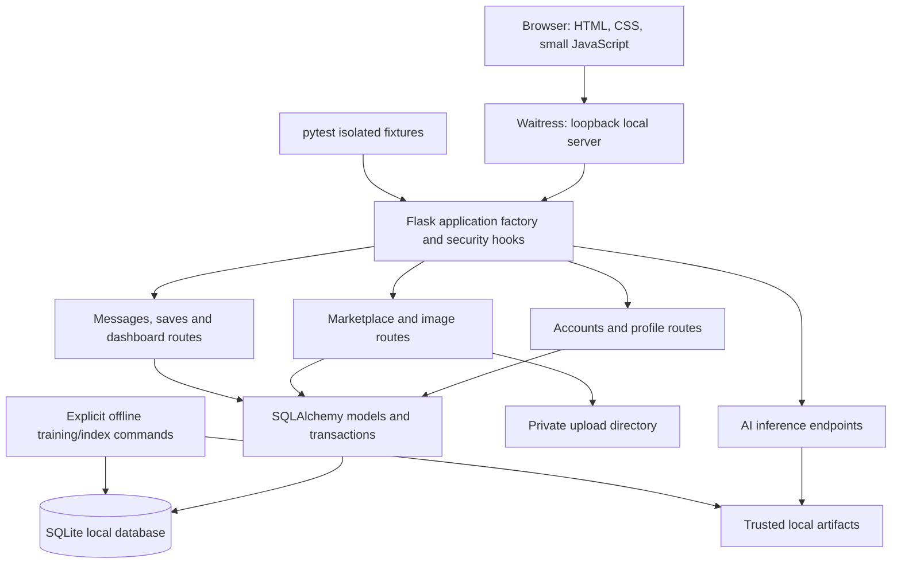
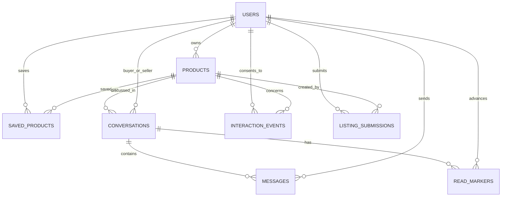

# Market Mirror — local release report

Date: 2026-10-25. Scope: approved MM-001–016, local-only operation.

## Summary and boundary

Market Mirror connects sellers and buyers through a server-rendered marketplace.
The local implementation includes accounts, listings/photos, discovery, saves,
private conversations, dashboards, consented events, and three advisory AI features.
It does not process money, arrange delivery, verify email ownership, reset lost
passwords, or promise that a seller/product is trustworthy. It is a university
project, not a fully staffed public commerce service.

The calendar-based proposal is retained as history. The approved phase roadmap
and later specification package governed implementation. Specification approval
came before the implementation/test plan. The core marketplace and AI/operations
tests were collected and observed failing before their features were implemented.
Additional hardening tests exposed concrete gaps which were then corrected.

## Architecture

Flask blueprints separate features without introducing microservices. A single
application is easier to run and understand at this scale. The application factory
creates isolated configurations: tests use their own database, upload root and AI
folder; they never silently fall back to the student's development database.

Requests are validated in forms, authorized in route/service logic, and checked
again with database constraints. Templates escape text. JavaScript inserts AI
responses with `textContent`, not `innerHTML`. CSRF protection covers state changes
and the authenticated prediction endpoints. GET requests remain read-only.

### Relational structure

`rate_limits` is an auxiliary table keyed by HMAC scope/identity digests. Foreign
keys restrict destructive deletion. A conversation is unique per product/buyer;
a saved relationship per user/product; message tokens per sender. Product versions
detect stale edits. Data migration history freezes schema operations instead of
importing today's model definitions into old migrations.

The populated-database upgrade needed a correction during development: SQLite
batch reconstruction of the referenced users table conflicted with foreign keys.
An isolated regression test reproduced it. Native add-column operations fixed it;
existing users/products were preserved after a guarded recovery backup. See
`tests/003-016-verification.md` for the historical incident, not just the final pass.

## AI data/model card

| Property | Executed release |
|---|---|
| Data | 168 project-authored synthetic rows; 24 in each of 7 categories |
| Provenance | `project-authored-synthetic-v1`; invented asking prices |
| Grouping | 84 product-type groups; variants remain together |
| Partition | 98 train / 28 validation / 42 test; seed 42 |
| Dataset SHA-256 | `1ecd346a8c88604dd3b0f919064b8e2b8053fddd2411dac8b9bd8d4e6822646b` |
| Model version | `mm-1ecd346a8c88` |
| scikit-learn | 1.9.1 |
| Category pipeline | TF-IDF (1–2 grams, max 10,000) + logistic regression, C=4 |
| Category threshold | 0.60, specified before evaluation |
| Price candidate | TF-IDF + category/condition one-hot features + Ridge, alpha=10 |
| Price selection | Validation MAE comparison against training-only medians |
| Recommendation model | Offline TF-IDF cosine similarity over public listing text/category |

The feature allow-list excludes price targets, identity, provenance and private
messages. Exact normalized copies cannot cross supplied groups. A near-copy check
also rejects equal normalized titles whose description-token Jaccard similarity
is at least 0.90 across groups. This heuristic is limited: a real dataset needs
manual review for paraphrases, near-identical products and source-specific leakage.

### Observed synthetic results

| Metric | Result |
|---|---:|
| Category test macro-F1 / accuracy | 1.0000 / 1.0000 |
| Majority baseline macro-F1 | 0.035714 |
| Category suggestion coverage / suggested-item accuracy | 1.0000 / 1.0000 |
| Ridge validation MAE | $11.9365 |
| Median baseline validation MAE | $11.7321 |
| Selected price method | Category/condition median, then category/global fallback |
| Selected price test MAE | $11.7738 |
| Median absolute test error | $12.00 |
| Price test count | 42, six per category |

These are observed outputs, not claimed real-market accuracy. Each category
shares deliberately obvious vocabulary, so perfect classification is unsurprising.
Prices follow an invented generator, not sales observations. Ridge did not beat
the baseline on validation; deploying the baseline is the correct outcome of
that comparison. The model does not know whether a product will sell or at what
final negotiated price. The validation 80th-percentile absolute error was $13.00;
the current UI does not present this as a confidence interval.

Per-class precision/recall/F1, confusion matrix, per-category price MAE and the five
largest price errors are saved in `instance/ai/evaluation.json`. Exact split IDs,
data card, quarantine and manifest are alongside it. This directory is ignored
because artifacts are regenerated locally; the data generator and report summary
are part of source. Re-training changed choices after viewing test results would
make further test estimates exploratory; do not tune to achieve a prettier score.

Recommendations have deterministic fixture tests and live visibility re-checks.
There is no legitimate held-out real-user interaction dataset, so this report
does **not** claim real-user precision@6, recall@6 or engagement lift. Candidate
retrieval is bounded to the newest 500 active products, with a two-per-seller
preference, deterministic ties and category-diverse fallback. Future large-scale
retrieval and formal ranking evaluation require another specification/data review.

## Security and privacy choices

- Salted scrypt password hashes; signed cookies; eight-hour sessions; POST logout.
- Server-derived ownership and sender identity; private-resource guessing gets 404.
- CSRF, escaped HTML, parameterized SQL, allow-listed sorts and input limits.
- DB-backed throttles; no trust in arbitrary client forwarded headers.
- Images decoded, bounded, normalized and served through visibility checks.
- Exact prices, explicit transactions, request tokens and optimistic versions.
- Personalization off by default; no anonymous tracking or message-text training.
- Safe request IDs/status/duration logs; private values excluded from error text.
- Models only from trusted offline generation, checksum/version validated.

These controls reduce specific risks; they do not prove that all vulnerabilities
or edge cases have been eliminated. See the traceability and operations documents
for unverified checks and release limits.

## Delivery status

Local core implementation and automated evidence are available. Public hosting
was explicitly excluded by the user's choice. PostgreSQL, Linux containers,
reverse-proxy/HTTPS behaviour and production restore remain unverified on this
Windows machine. The report and demo are prepared; the student's own presentation
and understanding cannot be signed off by the coding assistant.

## Technical references

- [Flask-SQLAlchemy quickstart](https://flask-sqlalchemy.palletsprojects.com/en/stable/quickstart/)
- [Flask-Migrate documentation](https://flask-migrate.readthedocs.io/en/latest/)
- [SQLAlchemy SQLite dialect](https://docs.sqlalchemy.org/en/20/dialects/sqlite.html)
- [Flask-Login documentation](https://flask-login.readthedocs.io/en/latest/)
- [Flask-WTF CSRF protection](https://flask-wtf.readthedocs.io/en/1.2.x/csrf/)
- [Pillow image API](https://pillow.readthedocs.io/en/stable/reference/Image.html)
- [scikit-learn common pitfalls](https://scikit-learn.org/stable/common_pitfalls.html)
- [scikit-learn model persistence](https://scikit-learn.org/stable/model_persistence.html)
